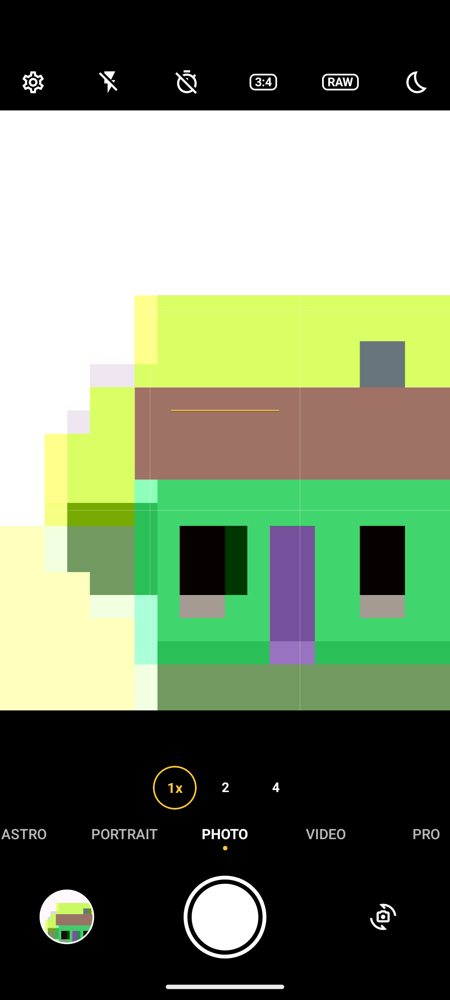
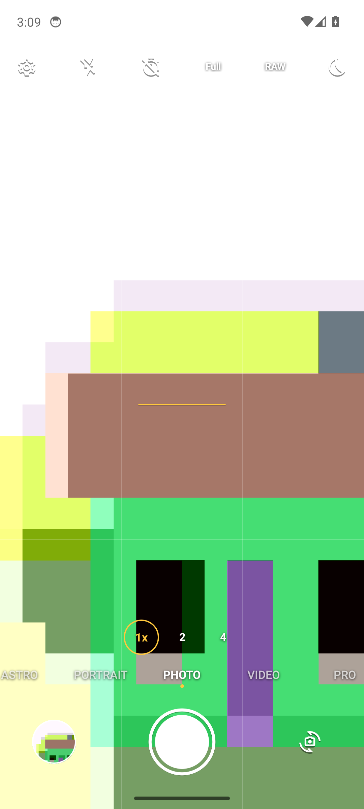
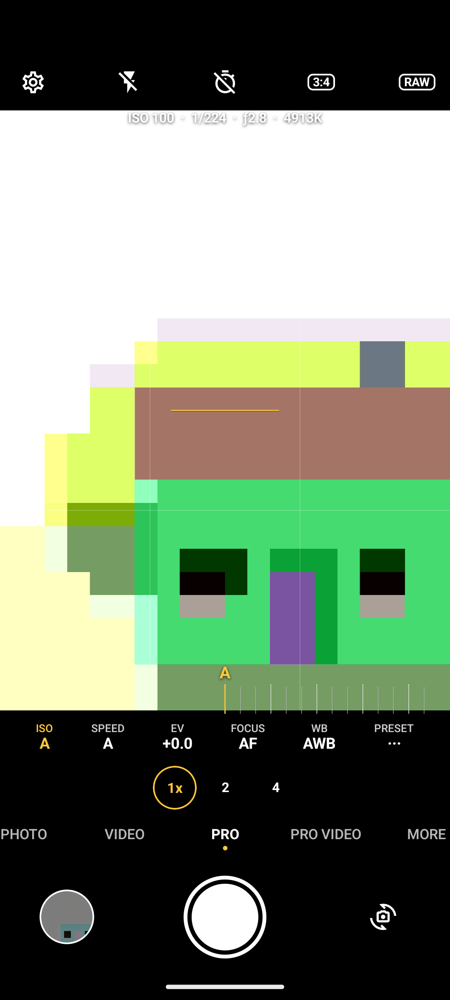
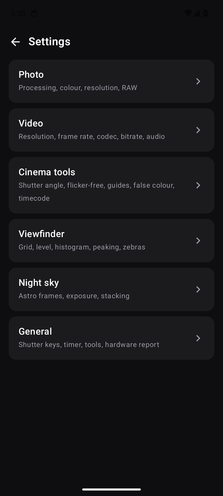
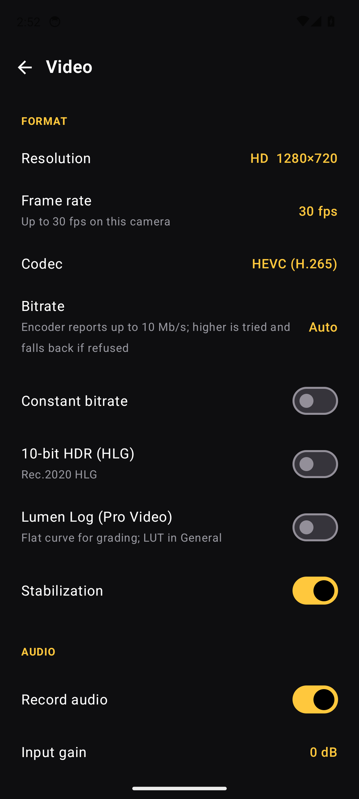

# Lumen Camera

[](https://github.com/jeshiomurmu/lumen-camera/actions/workflows/build.yml)
[](https://github.com/jeshiomurmu/lumen-camera/actions/workflows/device-tests.yml)
[](https://github.com/jeshiomurmu/lumen-camera/releases/latest)
[](LICENSE)


**Open-source pro camera for Android and iOS.** It merges bursts of RAW frames the way Google's HDR+ does, stacks the night sky, gives you full manual control, saves 16-bit DNG, records Log / HDR / ProRes video, and runs AI denoise and AI zoom on the phone. Everything is built on one shared C++ imaging core you can test on a laptop.

⭐ If you like the idea, star the repo; it helps other people find it. Phone owners: a [device report](https://github.com/jeshiomurmu/lumen-camera/issues/new?template=device-report.yml) from your phone is the most useful contribution right now (see [CONTRIBUTING.md](CONTRIBUTING.md)).

A pro camera app for **Android** (Kotlin + Jetpack Compose + Camera2) and **iOS** (Swift + SwiftUI + AVFoundation). Both apps share one open-source C++ imaging core. The core does HDR+-style burst merging, night and astro stacking, colour science and DNG writing. Open-source AI models run on the device for denoising and zoom. The interface is an original flagship-style layout: lens pills, a mode carousel, a Pro panel with ruler dials, and a big shutter.

Every hardware capability is reached through **public platform APIs only**, at the highest level each phone exposes. There is no root, no HAL patching, no private iOS APIs and no thermal-limit bypass. [docs/HARDWARE_UNLOCKS.md](docs/HARDWARE_UNLOCKS.md) explains why, and what that means for each feature.

## Features

| | Android | iOS |
|---|---|---|
| **Photo engine** | Lumen burst (RAW align + robust merge) · device ISP · OEM Camera2 extensions (Night, HDR, Bokeh, …) | Lumen burst (Bayer RAW brackets) · Apple pipeline (Photonic Engine / Deep Fusion) · Apple ProRAW |
| **Resolution** | Full sensor (`SENSOR_PIXEL_MODE_MAXIMUM_RESOLUTION`: 50 / 200 MP where offered) | Up to 48 MP (Apple pipeline / ProRAW); 12 MP Bayer RAW for the Lumen burst |
| **Night** | Handheld burst, up to 15 frames, OIS-aware exposure plan | Same plan, using bracketed RAW captures |
| **Astro** (tripod) | Star detection → triangle matching → RANSAC → sigma-clip / median / mean / star-trail stack · dark frames · hot pixels · gradient removal · auto-stretch | same core |
| **Pro (manual)** | ISO, shutter (up to the sensor maximum), EV, manual focus, Kelvin WB + tint, presets · Android 16 shutter/ISO priority | ISO, shutter, EV, lens position, Kelvin WB + tint, presets · Camera Control sliders (ISO, focus, zoom, EV) |
| **RAW** | DNG 1.4 (merged bursts: 16-bit, cleaner than one frame) | Original Apple DNG / ProRAW + Lumen-merged DNG |
| **AI** (open source) | FFDNet denoise, Real-ESRGAN ×4 "AI zoom" via ONNX Runtime + NNAPI | same models converted to Core ML (Neural Engine) |
| **Video** | HEVC / AVC / AV1 / APV (Samsung's pro codec, Android 16) · bitrate up to the encoder maximum · 10-bit HLG · Lumen Log + `.cube` LUT · open gate 4:3 · 120/240 fps high speed | HEVC / H.264 / ProRes 422 HQ / ProRes RAW (iPhone 17 Pro, iOS 26) · bitrate control where iOS allows it · HLG · Apple Log / Apple Log 2 · open gate · strongest stabilization mode |
| **Audio** | AAC 48 kHz stereo, external mics | AAC or 24-bit PCM, external USB-C / Bluetooth mics |
| **Viewfinder** | RGB + luma histogram, focus peaking, zebras, level, grid | + luma waveform |
| **Safety** | Thermal warning; stops recording when severe | Thermal warning; stops recording when critical |

## Test results

Every push runs the core test suite and the real apps on an **Android emulator** and an **iOS Simulator** in GitHub Actions ([device-tests.yml](.github/workflows/device-tests.yml)). The Android test drives the actual UI through its accessibility labels (shutter, aspect ratio, settings, modes) and reads the app's own timing log. Raw logs, screenshots and the captured files are in [`docs/test-results/`](docs/test-results), which the workflow updates after each run.

### Camera app (Android 14 emulator, API 34, x86_64, 2 cores)

| Test | Result |
|---|---|
| Cold launch | 1.7 s, no crashes |
| Leave the app and come back | camera reopens |
| Photo, phone processing: shutter free again | **0.27 – 0.56 s** after the tap (file written in the background) |
| Photo, phone processing: file saved | 0.41 – 0.94 s after the tap |
| 5 taps, 300 ms apart | **5 / 5 photos saved** within 3.5 s |
| Aspect 3:4 | saved 1856×1392 → 1.333 ✅ |
| Aspect 9:16 | saved 1280×720 → 1.778 ✅ |
| Aspect 1:1 | saved 1392×1392 → 1.000 ✅ |
| Aspect Full | saved 1280×576 → 2.222 = screen ratio ✅ |
| Night (merge of 8 phone frames) | shutter free 1.7 s, saved 3.5 s |
| Lumen RAW merge | shutter free 0.74 s, saved 10.2 s (merging on the emulator's 2 cores) |
| Settings → Video → Bitrate 150 Mb/s | selectable ✅; frame rates listed = every rate the camera offers |
| Video recording | file saved, playable (H.264 1280×720) |
| Camera calls blocking the UI thread | **0** (was several per run before 1.0.14) |
| UI frame time, 50th / 90th percentile | **34 / 61 ms** (was 57 / 89 ms) on software-rendered emulator graphics |

### Imaging core (same C++ on both platforms)

| | Android emulator | iPhone 17 Pro Max Simulator, iOS 26.5 |
|---|---|---|
| Core test suite | **103 / 103 passed** | **103 / 103 passed** |
| Night merge of phone (YUV) frames, 8 frames, handheld shift | luma +7.1 dB, colour noise +8.7 dB, 0 ghost pixels | identical |
| 8-frame RAW burst (handheld shake) | 31.64 → 37.04 dB PSNR (+5.40 dB) | identical |
| Astro star registration | 0.663° found vs 0.660° true | identical |
| 12 MP night merge speed | 419 ms / frame (2 cores) | 149 ms / frame |

<p>





</p>

*3:4 · Full · Pro · Settings · Video settings, from the emulator run (its camera shows a synthetic scene).*

**What these tests cannot show:** an emulator has no real sensor, lens or hardware video encoder. Its software H.264 encoder tops out at 12 Mb/s and its scene barely moves, so the video bitrate and frame rate it measures say nothing about a real phone. Frame times come from software-rendered graphics and are much slower than on a phone. Real-world photos (landscapes, night, video) from real phones are very welcome: please open a [device report](https://github.com/jeshiomurmu/lumen-camera/issues/new?template=device-report.yml).

## Repository layout

```
core/            C++17 imaging core (shared). Public C API: core/include/lumen_core.h
  src/           align, merge, finish, color, astro, dng, lut
  tests/         synthetic-camera test suite + DNG validation (LibRaw)
  tools/         lumen_cli: run the pipeline on DNGs from a PC
android/         Android Studio project (Gradle wrapper included)
ios/             XcodeGen spec (project.yml) + Swift sources
tools/           export_models.py: downloads official weights, exports ONNX
luts/            LumenLog_to_Rec709.cube
docs/            ARCHITECTURE.md, HARDWARE_UNLOCKS.md
```

## Download

Ready-made installers are on the [Releases page](https://github.com/jeshiomurmu/lumen-camera/releases/latest), built by GitHub Actions on every push:

- **Android:** open the `.apk` on your phone and allow installing unknown apps.
- **iOS:** sign and install the `-unsigned.ipa` with [Sideloadly](https://sideloadly.io) or [AltStore](https://altstore.io) using your Apple ID (re-sign every 7 days with a free Apple ID).

## Build

### 1. Imaging core and tests (PC — optional, but a quick sanity check)

```bash
cmake -S core -B build -DCMAKE_BUILD_TYPE=Release
cmake --build build -j
./build/lumen_tests out/            # 82 checks; writes PPM previews + DNGs
pip install rawpy tifffile numpy && python core/tests/validate_dng.py out/
./build/lumen_cli merge --profile vivid --dng merged.dng out.ppm burst_*.dng   # your own uncompressed DNGs
```

### 2. AI models (once, on a PC or Google Colab)

```bash
pip install torch onnx onnxruntime numpy
python tools/export_models.py --out models
cp models/*.onnx android/app/src/main/assets/models/
# iOS: add --coreml to the export, then for each model:
# xcrun coremlcompiler compile models/<name>.mlpackage ios/LumenCamera/Resources/Models/
```

The script downloads the official FFDNet and Real-ESRGAN weights. It exports fixed-tile ONNX graphs that the Neural Engine and NNAPI can run whole, and checks them against PyTorch. Without the models the apps still work; the AI switches simply have no effect.

### 3. Android

Open `android/` in Android Studio (AGP 8.13, Gradle 8.14.3). Install **NDK** and **CMake 3.22.1** from the SDK Manager, then run on a device (Android 10+; Android 16 unlocks the priority-AE and CCT white-balance keys).

### 4. iOS

```bash
brew install xcodegen
cd ios && xcodegen            # generates LumenCamera.xcodeproj
open LumenCamera.xcodeproj    # set your Team under Signing, run on an iPhone
```

You need **Xcode 26** (iOS 26 SDK). The app runs on iOS 17+; features that need a newer iOS are guarded at runtime. For AI on iOS, run the export with `--coreml` and compile the models into `ios/LumenCamera/Resources/Models/` with `xcrun coremlcompiler compile <model>.mlpackage ios/LumenCamera/Resources/Models/`.

## Contributing

See [CONTRIBUTING.md](CONTRIBUTING.md) for the roadmap, how to run the core tests without a phone, and good first tasks. Bug reports and feature ideas go in [Issues](https://github.com/jeshiomurmu/lumen-camera/issues/new/choose).

## Design decisions

- **Original UI.** The layout follows flagship camera conventions, but it uses no Samsung (or other) icons, artwork, fonts or trademarked feature names.
- **No root, Xposed or HAL patches.** These are device-specific, unverifiable from source, and can brick a phone or break banking/DRM attestation. The app gets the most each phone allows through public APIs. Those limits are set by the vendor.
- **No thermal bypass.** Throttling protects the battery and the sensor. The app warns you and stops a recording before the system has to.
- **No private iOS APIs.** They break between iOS versions and would get the app rejected.

## Credits

- HDR+ burst pipeline: Hasinoff et al., *Burst photography for high dynamic range and low-light imaging on mobile cameras*, SIGGRAPH Asia 2016 (re-implemented).
- Demosaic: Malvar, He & Cutler 2004. Exposure fusion: Mertens, Kautz & Van Reeth 2007. Guided filter: He, Sun & Tang.
- Planckian locus: Kim et al. Star matching: triangle-invariant matching after Valdes et al. (the idea behind *astroalign*). Auto-stretch: PixInsight-style midtone transfer.
- AI models: **FFDNet** (Kai Zhang et al., KAIR, MIT) and **Real-ESRGAN general-x4v3** (Xintao Wang et al., BSD-3-Clause), run with **ONNX Runtime** (MIT).

Lumen Camera is licensed under Apache-2.0 (see `LICENSE`). Third-party notices are in `NOTICE`.
